# License Management System — Architecture

| | |
|---|---|
| **System** | B2B License Management System (LMS) |
| **Version** | v1 (iteration 1: core workflows, end-to-end) |
| **Stack** | React + TypeScript + Vite · Node.js + Express 5 + TypeScript · PostgreSQL 16 |
| **Style** | 3-tier **modular monolith**, stateless API, single relational database as source of truth |

---

## Contents

1. [Problem & scope](#1-problem--scope)
2. [Architectural drivers](#2-architectural-drivers)
3. [Chosen architecture & why](#3-chosen-architecture--why)
4. [System context](#4-system-context)
5. [Containers](#5-containers)
6. [Backend architecture](#6-backend-architecture)
7. [Frontend architecture](#7-frontend-architecture)
8. [Data architecture](#8-data-architecture)
9. [Key runtime flows](#9-key-runtime-flows)
10. [Concurrency & consistency](#10-concurrency--consistency)
11. [Security architecture](#11-security-architecture)
12. [Error handling model](#12-error-handling-model)
13. [Deployment view](#13-deployment-view)
14. [Scalability path](#14-scalability-path)
15. [Architecture decision records](#15-architecture-decision-records)
16. [Known limitations & next iteration](#16-known-limitations--next-iteration)
17. [Traceability to the brief](#17-traceability-to-the-brief)

---

## 1. Problem & scope

An enterprise customer buys a **pool of N licenses** valid between a start and end date. Its administrators **assign** seats to employees (by email) and **revoke** them, never exceeding N. The vendor's **SaaS application** asks the LMS whether an employee currently holds a valid license.

**In scope (v1):** create pool, assign seat, revoke seat, verify license, audit history, admin UI, multi-tenant isolation by organization.
**Out of scope (v1):** billing/payments, pool editing, self-service admin/API-key provisioning (done by seed script), caching layers, message queues.

### Actors

| Actor | Type | Interacts via | Credential |
|---|---|---|---|
| Enterprise Admin (`ORG_ADMIN`) | Human | Admin UI | Email + password → JWT |
| Enterprise Viewer (`ORG_VIEWER`) | Human | Admin UI (read-only) | Email + password → JWT |
| SaaS Application | Machine | REST `POST /licenses/verify` | API key (`X-API-Key`) |
| Employee | Passive subject | — (never logs in) | Identified by normalized email |

---

## 2. Architectural drivers

The architecture is shaped by a small number of **non-negotiable invariants** and quality attributes, in priority order:

| # | Driver | Consequence for the design |
|---|---|---|
| D1 | **Never more than N active seats**, even under concurrent requests | Need atomic check-and-update → a transactional database is the referee, not application memory |
| D2 | **Every assign/revoke is audited** (who, which employee, when) | Audit write must commit *atomically* with the business change |
| D3 | **Date window** governs both allocation and verification | Validity is *computed* at request time from one authoritative clock (the DB) |
| D4 | **Verify is on the SaaS hot path** and read-heavy | Single indexed query, no locks, stateless and horizontally scalable |
| D5 | **Tenant isolation & least privilege** | Organization derived from credentials only; separate credential types for humans and machines |
| D6 | **Simplicity / explainability** (time-boxed build, live review) | Few moving parts; one deployable API; explicit SQL for critical paths |

---

## 3. Chosen architecture & why

**A 3-tier modular monolith:** a React SPA, one stateless Express API organized into domain modules, and one PostgreSQL database.

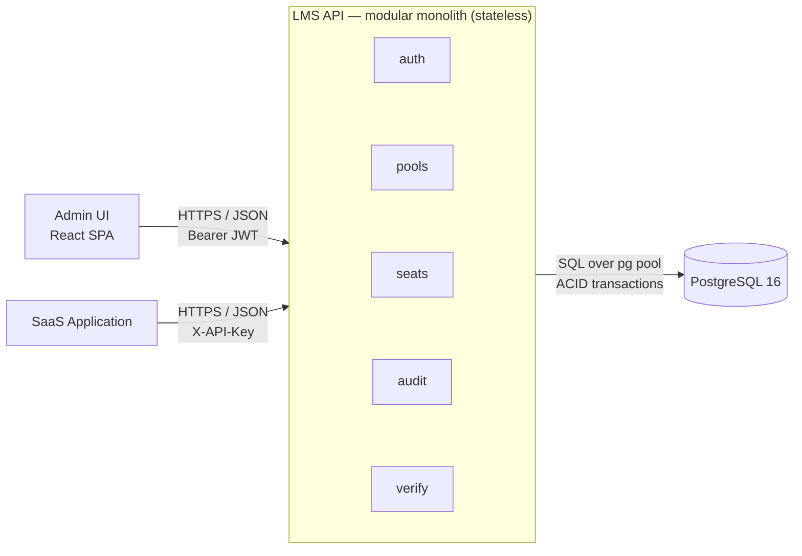

### Why this fits

1. **The core invariant needs ACID — and the cheapest correct way to get it is one relational database.**
   Reserving a seat, writing the seat row, and writing the audit row must succeed or fail *together*. In PostgreSQL that is a single local transaction. Row-level locks, `CHECK` constraints, and partial unique indexes give us concurrency safety **in the database**, so correctness does not depend on how many API instances run.

2. **A monolith keeps the transactional boundary intact.**
   Splitting seats and audit (or pools and seats) into separate services would turn one transaction into a distributed one — sagas, outbox, eventual consistency, compensation logic — to solve a problem we would have created. The domain is small (5 tables) and tightly coupled around one invariant.

3. **"Modular" keeps it evolvable.**
   Code is organized by domain module (`auth`, `pools`, `seats`, `audit`, `verify`), each with its own routes and repository. Boundaries are explicit, so a module (e.g. `verify`) could be extracted later if scale demanded it — without redesign.

4. **Stateless API ⇒ horizontal scale for free.**
   No session state lives in the API (JWT is self-contained; all coordination happens in Postgres). Any number of instances can run behind a load balancer.

5. **Read and write paths are separated by design, not by infrastructure.**
   Verify is one lock-free indexed read. When traffic grows, read replicas or a cache can be added behind the same contract (see [§14](#14-scalability-path)).

### Alternatives considered

| Alternative | Why rejected for v1 |
|---|---|
| **Microservices + message queue** | Breaks the single ACID boundary around seat + counter + audit; adds operational load (service discovery, tracing, retries, eventual consistency) with no benefit at this scale |
| **NoSQL (MongoDB / DynamoDB)** | Possible with conditional writes, but loses foreign keys, partial unique indexes, `CHECK` constraints, and simple multi-row transactions — all of which we rely on for D1/D2 |
| **Serverless functions** | Cold starts on the verify hot path; DB connection-pool exhaustion without extra infrastructure (RDS Proxy etc.) |
| **Application-level locking (mutex / Redis lock)** | Only correct if *every* writer uses it; a DB constraint is correct for every writer, including manual SQL and future services |
| **ORM for all data access** | ORMs hide the exact atomic SQL that guarantees D1; raw parameterized SQL via `pg` keeps the critical statements visible and reviewable |

---

## 4. System context

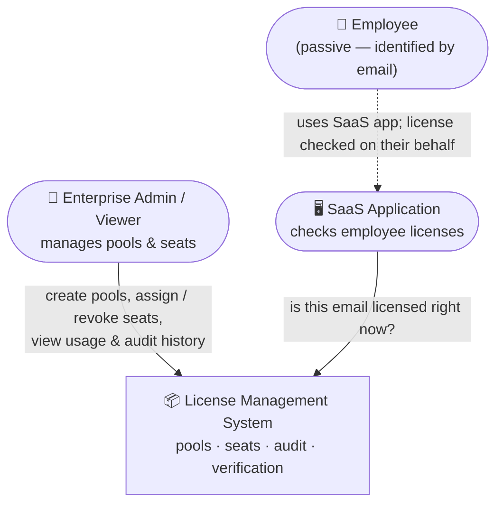

---

## 5. Containers

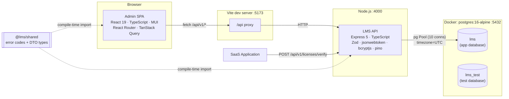

| Container | Technology | Responsibility |
|---|---|---|
| **Admin SPA** | React 19, TypeScript, Vite, MUI, React Router, TanStack Query | Login, pool list/creation, seat assignment/revocation, audit view, SaaS verify simulator |
| **LMS API** | Node.js, Express 5, TypeScript, Zod, `pg` | Authentication, authorization, validation, business rules, transactions |
| **PostgreSQL 16** | Docker Compose | System of record; enforces invariants via constraints, locks, triggers |
| **@lms/shared** | TypeScript package (npm workspace) | Single source for error codes and API DTO types → frontend and backend cannot drift |

In development the SPA calls `/api` on its own origin and Vite proxies to the API, so the browser sees a single origin (no CORS round-trips). CORS is still configured on the API for non-proxied deployments.

---

## 6. Backend architecture

### 6.1 Layers

Each request flows through strictly separated layers; each layer has one job.

```mermaid
flowchart LR
    R["HTTP request"] --> MW
    subgraph MW["Middleware pipeline (app.ts)"]
        direction LR
        A1["requestId<br/>X-Request-Id"] --> A2["pino-http<br/>logging"] --> A3["helmet<br/>CORS"] --> A4["requireJsonBody<br/>415"] --> A5["express.json<br/>10kb limit"]
    end
    MW --> AU["authenticate<br/>requireAdmin / requireApiClient"]
    AU --> AZ["authorize<br/>requireRole"]
    AZ --> V["validate<br/>Zod → req.valid"]
    V --> H["route handler<br/>HTTP ↔ DTO"]
    H --> S["service<br/>business rules · transactions"]
    S --> RP["repository<br/>parameterized SQL"]
    RP --> DB[("PostgreSQL")]
    H -. "throw AppError / pg error" .-> EH["errorHandler<br/>→ error envelope"]
    S -. throw .-> EH
    RP -. "pg error" .-> EH
```

| Layer | Rules |
|---|---|
| **Middleware** | Cross-cutting only: correlation id, logging (credentials redacted, bodies never logged), security headers, body limits |
| **Auth** | Establishes `req.auth` (who + which organization). `organizationId` is *only* ever read from here |
| **Validate** | Zod schemas parse params/query/body; `.strict()` rejects unknown fields; emails normalized (trim + lowercase). Handlers read only `req.valid` |
| **Route handler** | Translates HTTP ↔ service calls; sets status codes and `Location` headers. No SQL, no business rules |
| **Service** | Business rules, transaction boundaries, domain errors (`AppError`) |
| **Repository** | SQL only, receives a `Queryable` (pool or transaction client) so several repositories can share one transaction |
| **Error handler** | The only place errors become HTTP responses; maps Postgres error codes; never leaks stack traces or SQL |

### 6.2 Modules

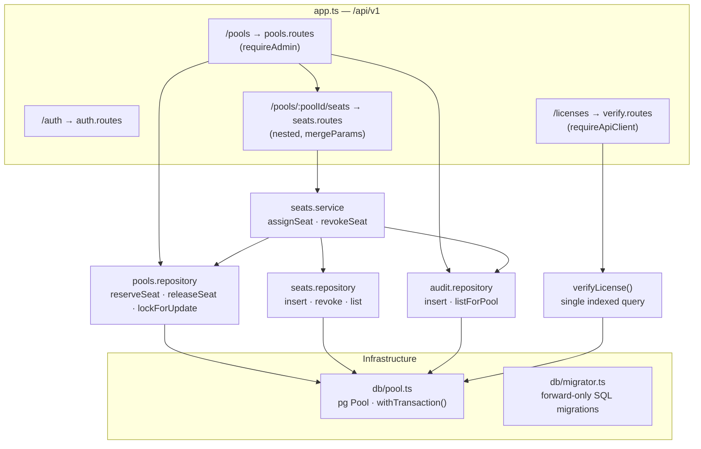

### 6.3 Transaction helper

`withTransaction(fn)` in [`backend/src/db/pool.ts`](../backend/src/db/pool.ts) is the single way to open a write transaction:

- Checks out **one dedicated connection**, `BEGIN`, sets `lock_timeout = 3s` and `statement_timeout = 5s`.
- `COMMIT` on success; `ROLLBACK` on *any* thrown error (business or infrastructure).
- Retries **once** on deadlock (`40P01`) or serialization failure (`40001`).
- Always releases the connection in `finally` (no pool leaks).

### 6.4 Source layout

```
backend/
  db/migrations/001_init.sql   schema, constraints, indexes, append-only trigger
  db/seed.ts                   idempotent demo data
  src/
    app.ts · server.ts         composition root · graceful shutdown
    config/env.ts              Zod-validated environment (fail fast at boot)
    db/                        pool + withTransaction, migrator
    middleware/                requestContext, auth, validate, errorHandler
    modules/                   auth · pools · seats · audit · verify
    lib/                       crypto, jwt, validation, cursor, pagination, logger
    errors/AppError.ts         domain error → error envelope
```

---

## 7. Frontend architecture

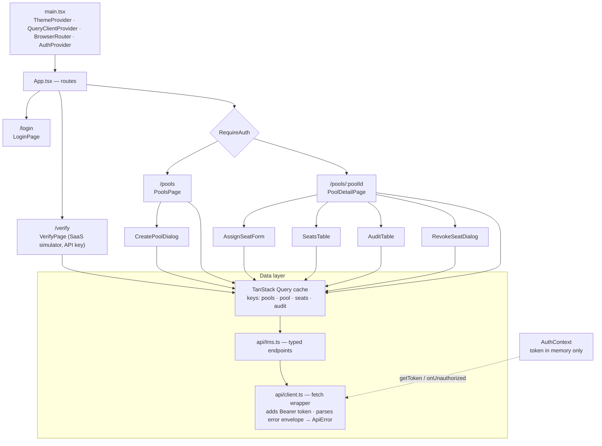

| Concern | Decision | Rationale |
|---|---|---|
| Server state | TanStack Query (`useQuery`, `useInfiniteQuery`, `useMutation`) | Caching, refetch, cursor pagination ("Load more"), loading/error states for free |
| Consistency after writes | After assign/revoke (success **or** failure) invalidate `pool`, `seats`, `audit`, `pools` | Another admin may have changed counts concurrently; the UI always re-reads the source of truth |
| Session | JWT held in React memory (not `localStorage`) | An XSS payload cannot read a persisted token. Trade-off: page reload requires re-login |
| 401 handling | `client.ts` calls `onUnauthorized` → logout + cache clear | Expired session returns the user to login without stale tenant data |
| Error display | `errorMessage()` switches on the stable `code` from `@lms/shared` | UI never parses human messages; distinct UX for `POOL_FULL` vs `POOL_NOT_ACTIVE` etc. |
| Role-aware UI | Create/assign/revoke controls hidden for `ORG_VIEWER` | Convenience only — the API enforces roles regardless |
| Client validation | Email format, capacity ≥ 1, end ≥ start | Fast feedback; the server re-validates everything |

---

## 8. Data architecture

### 8.1 Entity-relationship model

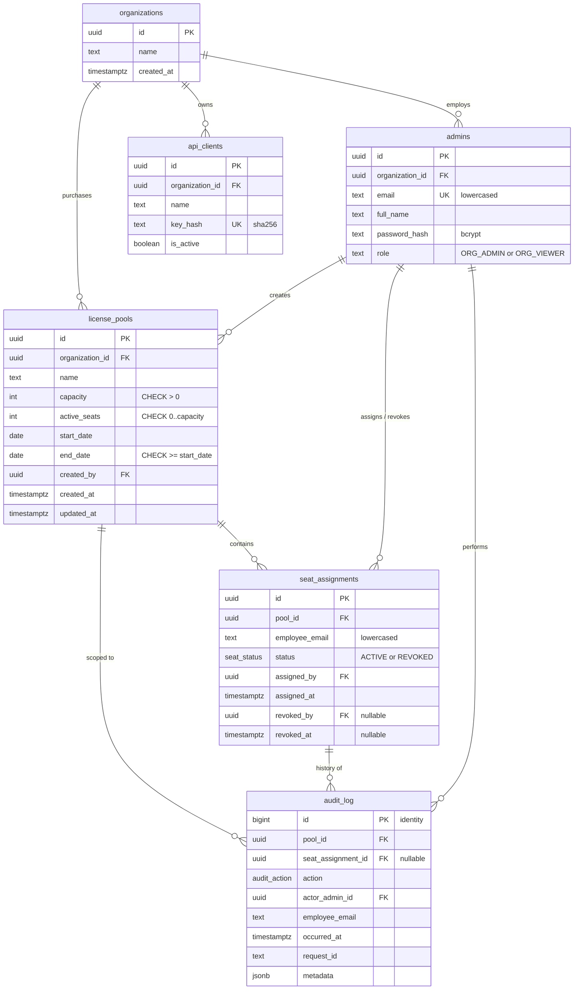

### 8.2 Modelling decisions

| Decision | Why |
|---|---|
| **No `employees` table** | Employees never log in; an email on the seat row is sufficient and avoids directory sync |
| **Revoke = state change**, never delete | Full history preserved; re-assignment creates a *new* row |
| **`active_seats` counter on the pool** | Enables a single atomic `UPDATE … WHERE active_seats < capacity`. `COUNT(*)`-then-`INSERT` races under READ COMMITTED |
| **Validity computed, not stored** | `CURRENT_DATE BETWEEN start_date AND end_date` at request time → expiry needs no cron job |
| **Dates as `DATE`, UTC, end inclusive** | Calendar semantics; DB sessions forced to `timezone=UTC`; `pg` DATE parser returns strings to avoid JS timezone shifts |
| **UUID ids; `BIGINT IDENTITY` for audit** | Unguessable ids in URLs; cheap, strictly ordered audit appends |
| **`organization_id` on pools / admins / api_clients** | Tenant scoping in every query; ready for row-level security or sharding |
| **All FKs `ON DELETE RESTRICT`** | Nothing referenced by history can be removed |

### 8.3 Invariants enforced by the database

| Invariant | Mechanism |
|---|---|
| Active seats ≤ capacity | `CHECK (active_seats >= 0 AND active_seats <= capacity)` |
| End date ≥ start date, capacity > 0 | `CHECK` constraints |
| One active seat per employee per pool | Partial unique index `uq_active_seat_per_pool (pool_id, employee_email) WHERE status='ACTIVE'` |
| Seat state is coherent | `chk_seat_state`: ACTIVE ⇒ no revoke fields; REVOKED ⇒ `revoked_at`, `revoked_by` set and `revoked_at ≥ assigned_at` |
| Emails canonical | `CHECK (email = lower(btrim(email)))` |
| Audit is append-only | `BEFORE UPDATE OR DELETE` and `BEFORE TRUNCATE` triggers raise an exception |
| Seat-related audit rows reference a seat | `chk_audit_seat_actions` |

### 8.4 Indexing strategy

| Index | Serves | Design note |
|---|---|---|
| `uq_active_seat_per_pool` | Duplicate prevention | **Partial** — revoked history does not block re-assignment |
| `idx_seat_verify (employee_email) INCLUDE (pool_id) WHERE status='ACTIVE'` | **Verify hot path** | Partial ⇒ small, contains only active seats; `INCLUDE` enables index-only scan before a PK lookup on the pool |
| `idx_seat_pool_listing (pool_id, status, assigned_at DESC, id DESC)` | Seat list + status filter + keyset pagination | Matches `WHERE` + `ORDER BY` exactly |
| `idx_audit_pool_id (pool_id, id DESC)` | Pool audit history, keyset by id | |
| `idx_audit_employee_time (employee_email, occurred_at DESC)` | "What happened to this person?" | Support/compliance lookups |
| `idx_pools_org (organization_id, created_at DESC, id DESC)` | Pool list per tenant + pagination | Tenant column first |
| `api_clients.key_hash` UNIQUE | API-key auth on every verify call | |

Pagination is **keyset (cursor) based**: cursors are opaque base64url tokens carrying the Postgres timestamp text (microsecond precision) plus id, so pages never skip or duplicate rows while data is being inserted.

---

## 9. Key runtime flows

### 9.1 Admin login

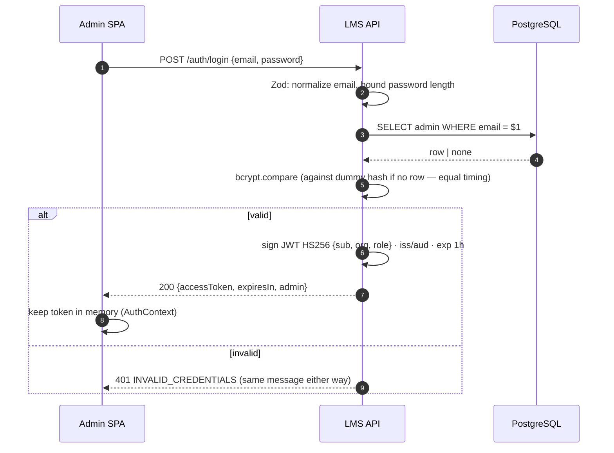

### 9.2 Assign seat — two admins race for the last seat

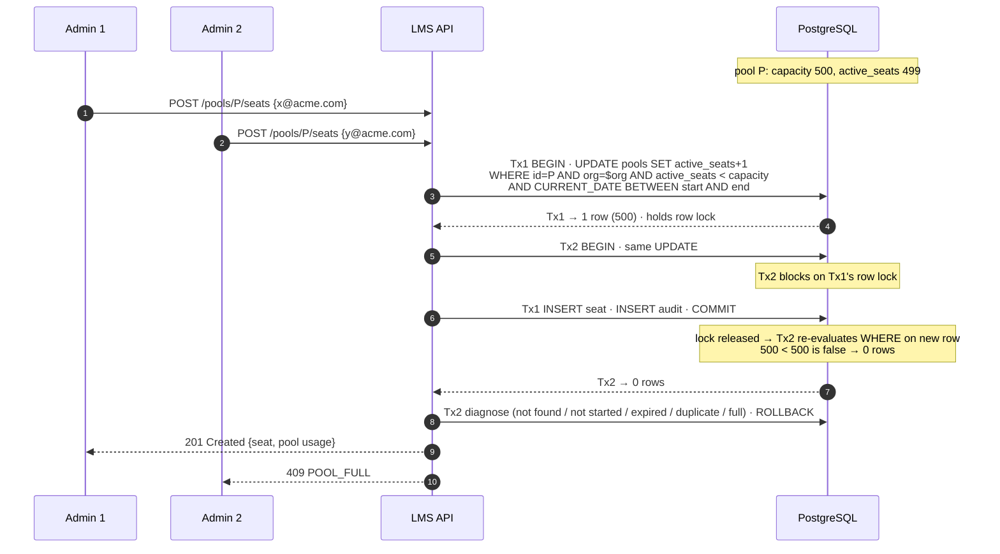

Diagnosis order when the reservation matches 0 rows: `POOL_NOT_FOUND` (404) → `POOL_NOT_ACTIVE` with `NOT_STARTED`/`EXPIRED` (422) → `SEAT_ALREADY_ASSIGNED` (409) → `POOL_FULL` (409). If the seat insert itself hits the partial unique index (`23505`), the whole transaction — including the counter increment — rolls back and the API returns `409 SEAT_ALREADY_ASSIGNED` with the existing `seatId`.

### 9.3 Revoke seat

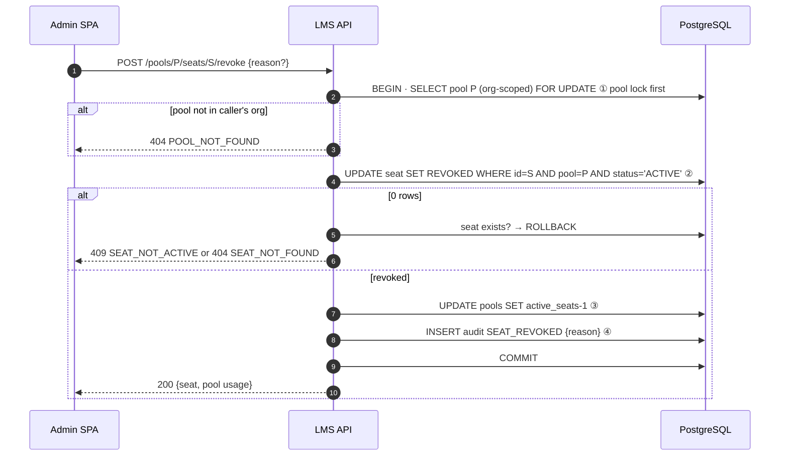

Revocation is permitted after a pool expires (clean-up); the date window applies only to assignment and verification.

### 9.4 Verify license (SaaS)

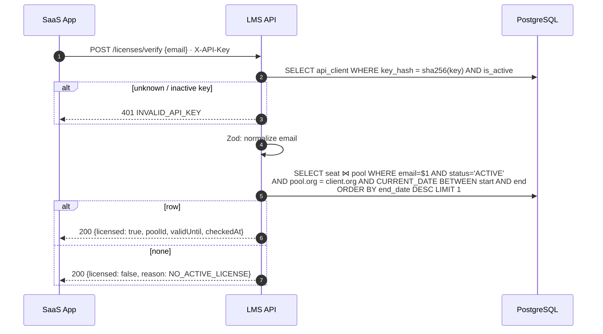

"Not licensed" is a valid answer and returns **200**, never 404. If the database is unreachable the API returns **503** — a client must never interpret an outage as "unlicensed". Verify uses `POST` so employee emails (PII) travel in the body, not in URLs that end up in proxy and access logs.

---

## 10. Concurrency & consistency

### 10.1 How the "≤ N" guarantee is enforced

**Both layers, with the database as the final authority:**

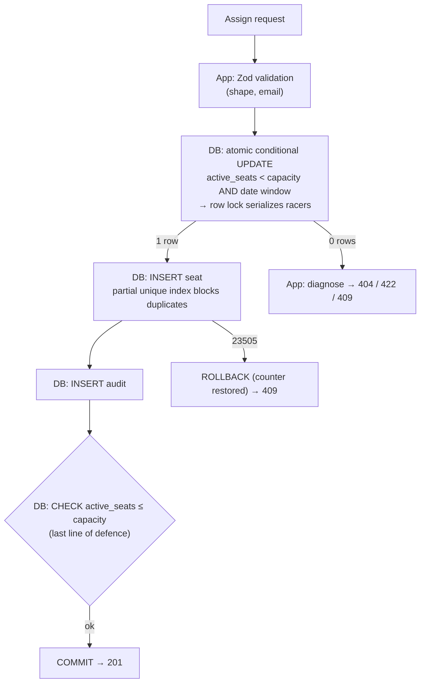

### 10.2 Why READ COMMITTED is sufficient

The conditional `UPDATE` acquires an exclusive row lock on the pool. A concurrent transaction targeting the same pool waits; once the first commits, PostgreSQL **re-evaluates the `WHERE` clause against the newly committed row version**. The loser therefore sees the pool as full and updates zero rows. No `SERIALIZABLE` isolation or application retry loop is needed.

### 10.3 Deadlock avoidance

Every write path acquires locks in the **same order: pool row → seat row**. Revoke explicitly takes `SELECT … FOR UPDATE` on the pool *before* touching the seat, matching assign. Without this, "revoke X" and "re-assign X" running concurrently could deadlock. As a backstop, `withTransaction` retries once on `40P01`.

### 10.4 ACID mapping

| Property | How it is achieved |
|---|---|
| **Atomicity** | Counter + seat + audit in one transaction; any failure rolls back all three |
| **Consistency** | DB constraints (`CHECK`, partial `UNIQUE`, FKs, triggers) make invalid states unrepresentable |
| **Isolation** | Row-level lock on the pool + READ COMMITTED re-check; MVCC means verify reads never block writes |
| **Durability** | PostgreSQL WAL; a committed seat and its audit row survive crashes |

### 10.5 Single clock

All date-window decisions (`CURRENT_DATE`) and pool status (`SCHEDULED`/`ACTIVE`/`EXPIRED`) are computed **by the database**, in a session forced to UTC. API servers' clocks are never consulted, so two API instances can never disagree about whether a pool is active.

### 10.6 Verified behaviour

The end-to-end suite (`npm run smoke`) fires 20 concurrent assign requests at a pool with 2 free seats and asserts exactly 2 × `201` and 18 × `409 POOL_FULL`; it also fires 3 concurrent revokes of one seat and asserts exactly one succeeds. A reconciliation query (`active_seats` vs. `COUNT(*) WHERE status='ACTIVE'`) returned zero drifted pools after the runs.

---

## 11. Security architecture

### 11.1 Trust boundaries

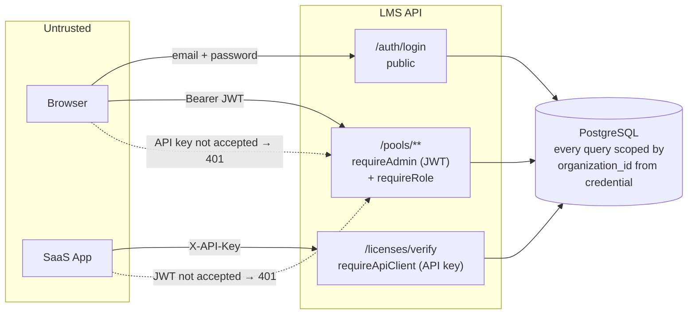

### 11.2 Controls

| Area | Control |
|---|---|
| **Admin authentication** | bcrypt (cost 12) password hashes; constant-work login (dummy hash for unknown emails) and identical error for both cases; JWT HS256 with pinned algorithm, issuer, audience, 1-hour expiry; secret from env, validated ≥ 32 chars at boot |
| **Machine authentication** | `lms_live_`-prefixed random API keys; only SHA-256 hash stored; `is_active` kill switch; keys can call verify **only** |
| **Authorization (RBAC)** | `ORG_ADMIN`: create pool, assign, revoke, read. `ORG_VIEWER`: read only. Wrong role → 403 |
| **Tenant isolation** | `organizationId` comes only from the credential; every repository query includes it; another tenant's pool returns **404** (no existence leak / IDOR) |
| **Audit integrity** | Actor id taken from the JWT, never from the request body; audit table append-only via triggers |
| **Input validation** | Zod at the edge; `.strict()` rejects unknown fields (no mass assignment); 10 kb body limit; JSON-only writes (415); UUID params validated before reaching SQL |
| **Injection** | Parameterized SQL (`$1, $2 …`) everywhere; no string-built queries from user input |
| **Transport / headers** | `helmet` security headers; CORS restricted to configured origin; `x-powered-by` disabled; `Cache-Control: no-store` on login and verify |
| **Logging & privacy** | `Authorization`, `X-API-Key`, cookies redacted; request bodies (which contain employee emails) never logged; errors correlated by `requestId` |
| **Client-side** | JWT kept in memory, not `localStorage` |

---

## 12. Error handling model

Every error response has the same envelope; `code` is a stable contract defined once in `@lms/shared`:

```json
{ "error": { "code": "POOL_FULL", "message": "License pool has no available seats (3/3 in use)",
             "details": { "capacity": 3, "activeSeats": 3 }, "requestId": "req_…" } }
```

| HTTP | Codes |
|---|---|
| 400 | `VALIDATION_ERROR` (with `details.fields[]`) |
| 401 | `UNAUTHENTICATED`, `INVALID_CREDENTIALS`, `INVALID_API_KEY` |
| 403 | `FORBIDDEN` |
| 404 | `NOT_FOUND`, `POOL_NOT_FOUND`, `SEAT_NOT_FOUND` |
| 409 | `POOL_FULL`, `SEAT_ALREADY_ASSIGNED`, `SEAT_NOT_ACTIVE` |
| 413 / 415 | `PAYLOAD_TOO_LARGE`, `UNSUPPORTED_MEDIA_TYPE` |
| 422 | `POOL_NOT_ACTIVE` (`details.reason`: `NOT_STARTED` \| `EXPIRED`) |
| 500 | `INTERNAL_ERROR` (logged with full detail server-side) |
| 503 | `SERVICE_UNAVAILABLE` (+ `Retry-After`) |

Infrastructure errors are translated centrally:

| PostgreSQL | API response |
|---|---|
| `23505` on `uq_active_seat_per_pool` | 409 `SEAT_ALREADY_ASSIGNED` |
| `40P01` / `40001` (after retry), `55P03` lock timeout, `57014` statement timeout | 503 `SERVICE_UNAVAILABLE` |
| Class `08`, `ECONNREFUSED`, pool connect timeout | 503 `SERVICE_UNAVAILABLE` |
| `23514` check violation, anything else | 500 `INTERNAL_ERROR` (indicates a bug) |

---

## 13. Deployment view

### 13.1 Local / review environment (as built)

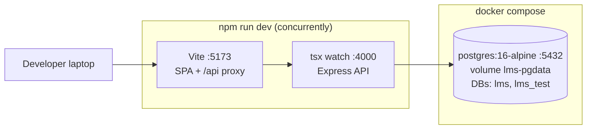

| Command | Purpose |
|---|---|
| `npm run db:up` / `db:migrate` / `db:seed` | Start Postgres, apply migrations (advisory-locked, transactional), seed demo data |
| `npm run dev` | API + SPA with hot reload |
| `npm run smoke` | End-to-end verification against the running stack |
| `npm run build` | `tsup` bundle for the API (`dist/server.js`), `vite build` for the SPA |
| `npm run db:reset` | Drop volume → migrate → seed |

### 13.2 Production target

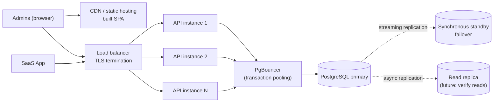

- API instances are stateless and interchangeable; `/health/live` (process up) and `/health/ready` (DB reachable) drive load-balancer health checks.
- `SIGTERM` triggers graceful shutdown: stop accepting connections, finish in-flight requests, close the DB pool.
- Secrets (`JWT_SECRET`, `DATABASE_URL`) come from the environment / secret manager; config is validated at boot and the process refuses to start if invalid.

---

## 14. Scalability path

The v1 design deliberately defers infrastructure until load justifies it; each step below is additive and does not change the API contract.

| Pressure | v1 (now) | Next step |
|---|---|---|
| Verify read volume | One partial-index lookup + PK join, lock-free under MVCC | Read replica for verify (accept seconds of replication lag after revoke, or route to primary) → Redis cache `verify:{org}:{email}` with short TTL, invalidated on revoke |
| Many API instances | `pg` pool of 10 per instance | PgBouncer in transaction mode |
| Hot pool (many assigns to one pool) | Row lock held ~1–2 ms ⇒ hundreds of assigns/s per pool; different pools never contend | Bulk assign: `active_seats + $k <= capacity` in one statement |
| Audit growth | Single append-only table | Monthly range partitioning on `occurred_at`; archive cold partitions |
| More tenants | `organization_id` in every query and leading every index | PostgreSQL row-level security; shard by `organization_id` (pools never cross tenants) |
| Rate limiting | Not yet (iteration 2) | Per-route limits; Redis-backed store once there is more than one instance |

---

## 15. Architecture decision records

| ADR | Decision | Status | Rationale (short) |
|---|---|---|---|
| 001 | Modular monolith, 3-tier | Accepted | Single ACID boundary for the core invariant; low operational cost; extractable modules |
| 002 | PostgreSQL as the only datastore | Accepted | Transactions, row locks, `CHECK`, partial unique indexes, triggers |
| 003 | Atomic conditional `UPDATE` on a stored counter for seat reservation | Accepted | One statement checks capacity + window and serializes racers; avoids `COUNT`-then-`INSERT` race |
| 004 | Enforce invariants in DB **and** app; DB is final authority | Accepted | Correct for every writer, including future services and manual SQL |
| 005 | Lock order pool → seat in all write paths | Accepted | Prevents assign/revoke deadlocks |
| 006 | Raw SQL via `pg` (no ORM) | Accepted | Critical statements visible, reviewable, and exactly what runs |
| 007 | Validity computed from DB `CURRENT_DATE` (UTC), not stored | Accepted | No cron jobs; single clock across instances |
| 008 | Separate credentials: JWT for admins, hashed API key for SaaS | Accepted | Least privilege; a leaked SaaS key cannot mutate seats |
| 009 | `POST /licenses/verify` (body) instead of `GET ?email=` | Accepted | Keeps PII out of URLs and access logs |
| 010 | Revoke as `POST …/revoke` state transition | Accepted | Nothing is deleted; carries an optional reason |
| 011 | Shared TypeScript package for error codes and DTOs | Accepted | Frontend and backend cannot drift on the contract |
| 012 | JWT in memory on the SPA | Accepted (v1) | XSS-resistant; trade-off is re-login on reload. Revisit with httpOnly refresh cookie |
| 013 | Keyset (cursor) pagination | Accepted | Stable pages under concurrent inserts; index-friendly |

---

## 16. Known limitations & next iteration

| Item | Notes |
|---|---|
| Automated test suite | Vitest + Supertest against `lms_test` (race, edge cases, tenancy). v1 is verified by the end-to-end smoke suite |
| Rate limiting | Login brute-force protection, per-admin and per-API-client limits |
| Idempotency keys | `Idempotency-Key` header to replay the original `201` on client retries (today a retry safely returns `409 SEAT_ALREADY_ASSIGNED` with the existing `seatId`) |
| Session persistence | Refresh-token flow (httpOnly cookie) so page reloads keep the session |
| Admin & API-key provisioning | Currently via seed script; needs platform-operator endpoints |
| Pool editing | Not supported; would need "capacity ≥ active seats" guard |
| Frontend bundle size | ~600 kB minified; add route-level code splitting |
| Counter reconciliation | Run the reconciliation query as a scheduled health check with alerting |

---

## 17. Traceability to the brief

| Brief deliverable / constraint | Where it is addressed |
|---|---|
| **A.** Architecture diagram with allocation & verification paths | §3, §5, §9.2, §9.4 |
| **B.** Schema: capacity & date range, assignments/revocations, audit, ≤ N enforcement | §8.1–§8.4, `backend/db/migrations/001_init.sql` |
| **C.** REST API with paths, methods, bodies, status codes, errors | §9, §12, `README.md` (endpoint table), `backend/src/modules/*` |
| **D.** Concurrency note — racing for the last seat | §9.2, §10 |
| Pool boundary → clear error when full | `409 POOL_FULL` (§9.2, §12) |
| Date window → reject allocation, verify reports unlicensed | Conditional `UPDATE` window check; verify query window check (§9.2, §9.4, §10.5) |
| Double allocation → only one succeeds | Row lock + re-check + `CHECK` constraint (§10), verified by smoke test (§10.6) |
| Who / which employee / when for assign & revoke | `audit_log` written in the same transaction; actor from JWT (§8, §11) |
